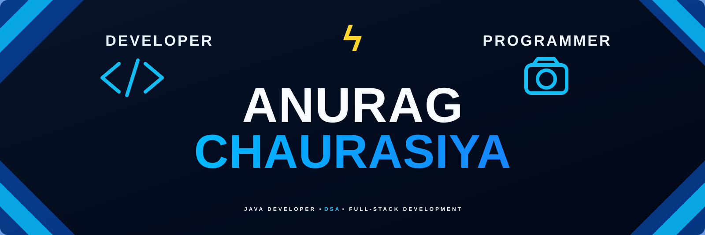

# ANURAG CHAURASIYA

### B.Tech Student | Java Developer | Data Structures & Algorithms

**Building a strong foundation in software engineering through problem-solving and practical projects.**

  
  
  

---

## Professional summary

I am a second-year B.Tech student focused on developing practical programming and software-development skills. My current learning path centers on **Java, object-oriented programming, data structures and algorithms**, alongside C++ and web fundamentals.

I use projects to turn concepts into working demonstrations, practise writing understandable code, and document what I build. I am actively strengthening my problem-solving ability and learning the software-development workflow.

## Technical skills

| Area | Skills |
|---|---|
| Programming | Java, C++ |
| Core concepts | OOP, Collections, Data Structures & Algorithms |
| Web fundamentals | HTML, CSS, JavaScript |
| Database | MySQL fundamentals |
| Tools | Git, GitHub, VS Code, Eclipse |

*Skills listed reflect my current learning and practice areas; proficiency is continuously developing.*

## Selected projects

<table>
  <tr>
    <td width="50%" valign="top">
      <h3><a href="https://github.com/anuragchaurasiya/HUFFMAN-TEXT-COMPRESSOR">Huffman Text Compressor</a></h3>
      
A project exploring lossless text compression through Huffman coding.

      
<strong>Concepts:</strong> Java, Greedy Algorithms, Binary Trees, Priority Queue.

      <a href="https://github.com/anuragchaurasiya/HUFFMAN-TEXT-COMPRESSOR">Source code</a>
    </td>
    <td width="50%" valign="top">
      <h3><a href="https://github.com/anuragchaurasiya/project-shield">PROJECT SHIELD</a></h3>
      
A planned, consent-based mobile security and recovery-support concept, documented with architecture, workflow and privacy considerations.

      
<strong>Focus:</strong> System Design, Android (planned), Backend (planned), Privacy.

      <a href="https://github.com/anuragchaurasiya/project-shield/blob/main/docs/FLOWCHART.md">Flowchart</a> ·
      <a href="https://github.com/anuragchaurasiya/project-shield/blob/main/docs/USER_GUIDE.md">How it works</a>
    </td>
  </tr>
  <tr>
    <td width="50%" valign="top">
      <h3><a href="https://github.com/anuragchaurasiya/repo07">CineBook — Movie Booking Demo</a></h3>
      
A browser-based movie ticket booking demonstration.

      
<strong>Concepts:</strong> HTML, CSS, JavaScript, DOM, LocalStorage.

      <a href="https://anuragchaurasiya.github.io/repo07/">Live demo</a> ·
      <a href="https://github.com/anuragchaurasiya/repo07">Source code</a>
    </td>
    <td width="50%" valign="top">
      <h3><a href="https://github.com/anuragchaurasiya/repo06">Movie Theater Booking</a></h3>
      
A console-based project for practising seat selection and booking logic.

      
<strong>Concepts:</strong> Java, OOP, Collections, File Handling.

      <a href="https://github.com/anuragchaurasiya/repo06">Source code</a>
    </td>
  </tr>
</table>

## Problem-solving

I practise data structures and algorithms to improve logical thinking and coding fundamentals.

- <a href="https://github.com/anuragchaurasiya/https-github.com-anuragchaurasiya-LeetcodeSalution">LeetCode solutions repository</a>
- <a href="https://leetcode.com/u/Anuragchaurasiya790/">LeetCode profile</a>

## Currently focusing on

- Strengthening Java, OOP and Collections.
- Practising arrays, linked lists, trees, recursion and problem-solving patterns.
- Improving C++ fundamentals and STL.
- Building, testing and documenting practical projects.
- Learning how frontend applications connect to backend services and databases.

## Development approach

- Write clear, readable and maintainable code.
- Explain project setup, usage and important design decisions.
- Test expected behaviour and handle common errors.
- Be transparent about implemented features, planned work and known limitations.

## Connect

- **GitHub:** [github.com/anuragchaurasiya](https://github.com/anuragchaurasiya)
- **LinkedIn:** [Connect with me](https://www.linkedin.com/in/anurag-chaurasiya-16388832b/)
- **LeetCode:** [View my practice](https://leetcode.com/u/Anuragchaurasiya790/)

*Learn continuously · Build practically · Improve consistently*

